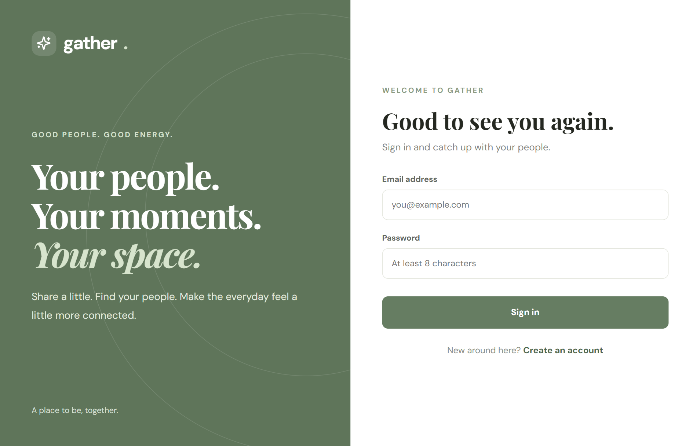
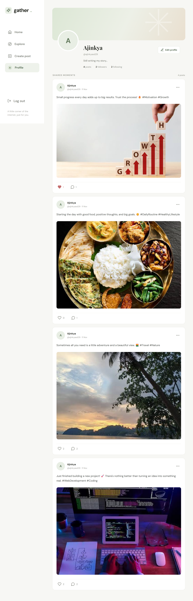
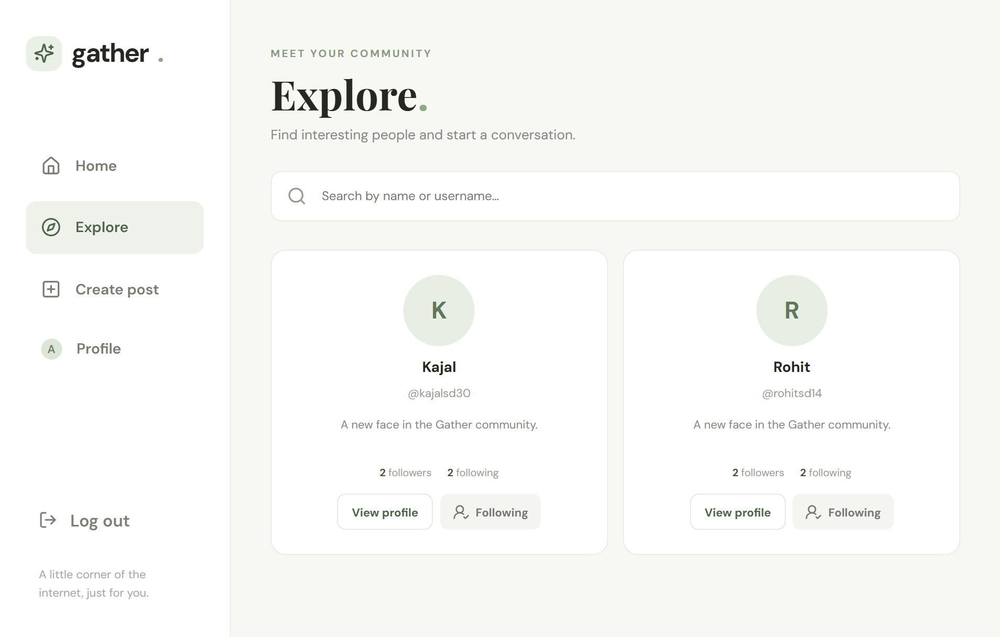

# MERN Social Media Platform

<p align="center">
  
  
  
  
  
  
</p>

A full-stack social media application built using the **MERN stack (MongoDB, Express.js, React.js, and Node.js)**. Users can create accounts, share posts, upload images, interact with other users, and explore content through a responsive interface.

## 📸 Screenshots

<!-- Replace these paths with your actual screenshot filenames -->

### Home Feed


### Login Page



### User Profile



### Explore Page



## ✨ Features

- **User Authentication** – Register and log in securely using JWT authentication.
- **User Profiles** – View and manage user profile information.
- **Create Posts** – Share posts with image uploads and captions.
- **Like Posts** – Like and unlike posts.
- **Comments** – Comment on posts and interact with other users.
- **Follow System** – Follow and unfollow users.
- **Home Feed** – View posts from users.
- **Explore Page** – Discover posts and other users.
- **Responsive Design** – Works across desktop, tablet, and mobile devices.
- **Protected Routes** – Restrict access to authenticated users.

## 🛠️ Tech Stack

**Frontend**

- React.js
- React Router
- Vite
- JavaScript (ES6+)
- CSS3

**Backend**

- Node.js
- Express.js
- MongoDB
- Mongoose
- JSON Web Token (JWT)
- bcrypt.js
- Multer

## 📁 Project Structure

```text
mern-social-platform/
│
├── client/
│   ├── public/
│   └── src/
│       ├── components/
│       ├── context/
│       ├── pages/
│       ├── services/
│       ├── App.jsx
│       └── main.jsx
│
├── server/
│   ├── config/
│   ├── controllers/
│   ├── middleware/
│   ├── models/
│   ├── routes/
│   ├── uploads/
│   ├── .env.example
│   └── server.js
│
├── screenshots/
│   ├── home-feed.png
│   ├── login.png
│   ├── profile.png
│   └── explore.png
│
└── README.md
```

## ⚙️ Installation & Setup

### 1. Clone the Repository

```bash
git clone https://github.com/YOUR_GITHUB_USERNAME/mern-social-platform.git
cd mern-social-platform
```

### 2. Install Backend Dependencies

```bash
cd server
npm install
```

### 3. Configure Environment Variables

Create a `.env` file inside the `server` directory:

```env
PORT=5000
MONGO_URI=mongodb://127.0.0.1:27017/mern-social-platform
JWT_SECRET=your_generated_jwt_secret
CLIENT_URL=http://localhost:5173
```

Generate a secure JWT secret using:

```bash
node -e "console.log(require('crypto').randomBytes(64).toString('hex'))"
```

### 4. Start the Backend

```bash
npm run dev
```

The backend will run at:

```text
http://localhost:5000
```

### 5. Install Frontend Dependencies

Open another terminal:

```bash
cd client
npm install
```

### 6. Start the Frontend

```bash
npm run dev
```

The frontend will run at:

```text
http://localhost:5173
```

## 🔐 Environment Variables

| Variable     | Description                            |
| ------------ | -------------------------------------- |
| `PORT`       | Backend server port                    |
| `MONGO_URI`  | MongoDB connection string              |
| `JWT_SECRET` | Secret key used for JWT authentication |
| `CLIENT_URL` | Frontend application URL               |

## 🔗 API Overview

The backend exposes REST API endpoints for the following operations:

| Module         | Functionality                                 |
| -------------- | --------------------------------------------- |
| Authentication | Register, login, get current user             |
| Users          | Get profiles, update profile, follow/unfollow |
| Posts          | Create, fetch, delete posts                   |
| Likes          | Like and unlike posts                         |
| Comments       | Add and retrieve comments                     |

All protected endpoints require a valid JWT authentication token.

## 🚀 Future Improvements

- Real-time notifications
- Direct messaging
- Stories functionality
- Search users and posts
- Save/bookmark posts
- Cloud image storage
- Infinite scrolling
- Real-time chat using Socket.IO

## 👨‍💻 Author

**Ajinkya Dhatrak**

GitHub: [@ajinkya029](https://github.com/ajinkya029)

---

⭐ If you like this project, consider giving it a star!
